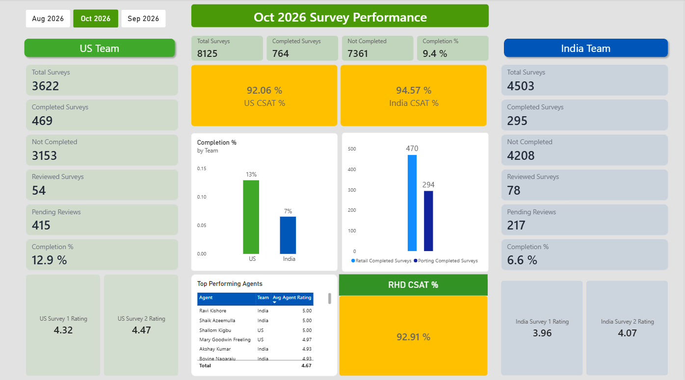
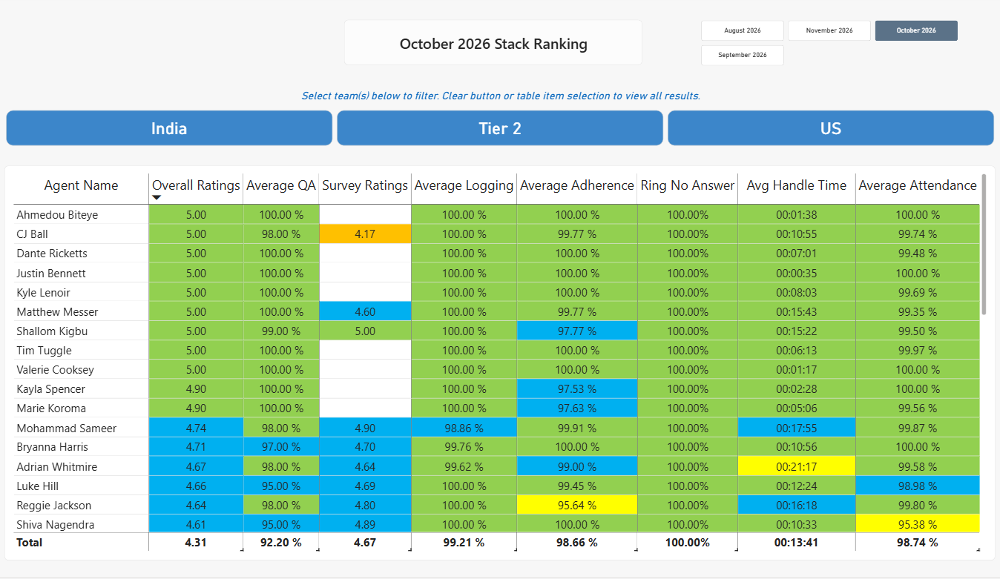
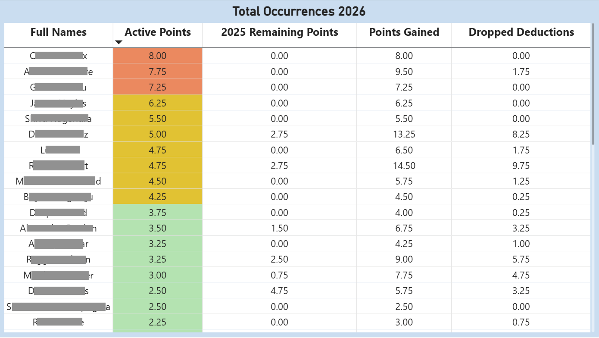
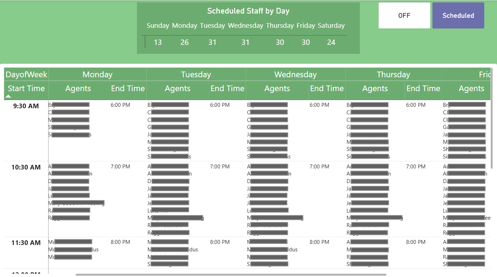
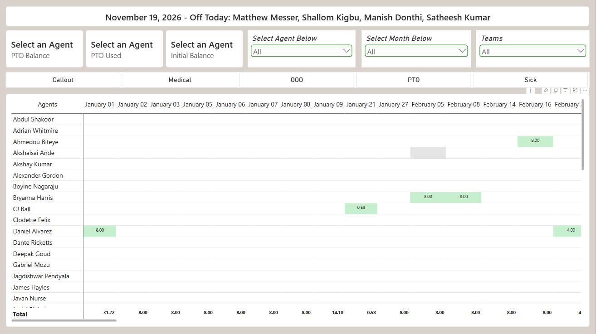

# Josue Cano — Portfolio

Hello! I'm **Josue Cano**, a Workforce Management Analyst, Technical Support Professional, and Power BI Developer passionate about transforming data into meaningful business insights.

My background spans Technical Support, Workforce Management, Customer Experience Analytics, and Technical Documentation, allowing me to bridge the gap between technical teams, business stakeholders, and leadership.

I specialize in building end-to-end reporting solutions that automate manual processes, improve operational visibility, and support data-driven decision-making. My projects focus on workforce performance management, customer satisfaction analytics, quality assurance reporting, and operational efficiency.

In addition to developing Power BI dashboards, I create technical documentation and knowledge resources that help simplify complex processes and improve organizational effectiveness.

---

## Featured Projects

> Click each project to expand details.

  
<strong>Platform #1 — Customer Satisfaction & Quality Assurance Analytics Platform</strong>

  ### Preview
  

### Focus Areas
- CSAT Reporting  
- Survey Analytics  
- Quality Assurance  
- Agent Performance  
- Semantic Modeling  
- DAX Development

  
<strong>Platform #2 — Workforce Performance Management & Stack Ranking Platform</strong>

   ### Preview
  

### Focus Areas
- Workforce Analytics  
- Performance Management  
- Coaching Analytics  
- KPI Automation  
- Operational Reporting  
- Workforce Scorecards

  
<strong>Platform #3 — Attendance Occurrence Management & Workforce Accountability Platform</strong>

  ### Preview
  

### Focus Areas
- Attendance Analytics  
- Workforce Governance  
- Corrective Action Tracking  
- Compliance Reporting  
- Employee Accountability  
- Attendance Policy Automation  
- Operational Analytics

  
<strong>Platform #4 — Workforce Scheduling & Staffing Visibility Platform</strong>

  ### Preview
  

### Focus Areas
- Workforce Management  
- Scheduling Analytics  
- Staffing Visibility  
- Capacity Planning  
- Resource Allocation  
- Coverage Analysis  
- Operational Planning  
- Workforce Optimization

  
<strong>Platform #5 — PTO & Time Off Management Analytics Platform</strong>

  ### Preview
  

### Focus Areas
- Leave Management Analytics  
- PTO Tracking  
- Workforce Availability  
- Staffing Impact Analysis  
- Capacity Planning  
- Resource Management  
- Operational Reporting  
- Workforce Planning

---

## Contact
If you'd like to connect or collaborate, feel free to reach out via email at joscan555@gmail.com or connect with me on LinkedIn at www.linkedin.com/in/josuecano0817

Thank you for visiting my Business Analytics Portfolio! 

